# Testes publicados do professor — evolução da lista persistente

Este documento acompanha **cada linha** de [`teste01.in` a `teste05.in`](../testes/) e confere as respostas com os respectivos `.out`. Cada arquivo começa de novo com a **versão 0 vazia**. As tabelas mostram a lista **atual** antes e depois do comando; em consultas históricas, a coluna “Efeito / leitura” também mostra a versão efetivamente lida. `∅` significa lista vazia.

## Como a estrutura funciona

A lista é encadeada e ordenada. `INC N` insere uma ocorrência de `N` e publica uma nova versão. `REM N` retira uma ocorrência, se existir, e **sempre** publica uma nova versão — até quando o conteúdo é igual. `IMP M` mostra a versão `M`; `SUC N M` encontra nela a primeira chave **estritamente maior** que `N`. As consultas não criam versões. Uma versão inexistente usa a última, conforme a regra de `IMP` no [enunciado](../TRABALHO.md) e a decisão do projeto para `SUC`.

No código, `heads_[v]` guarda a cabeça de cada versão. Os nós têm chave, elo base, até dois registros de modificação do elo e um predecessor da versão corrente. `next_at(nó, v)` escolhe o elo visível em `v`; `write_next` grava a mudança ou copia um nó cheio e propaga o ajuste até a cabeça. As representações `v0: ∅`, `v1: 1 → 2` nos diagramas são **visões lógicas**: elas não significam que toda a lista foi copiada fisicamente. Veja [`persistent_list.cpp`](../trabalhos/graduacao/persistent_list.cpp) e [`main.cpp`](../trabalhos/graduacao/main.cpp).

Em cada tabela, **Antes** e **Depois** são sempre o estado corrente. Para `IMP` e `SUC`, o estado corrente se repete nas duas colunas porque a operação só lê. O texto `vM [valores] ⇒ resposta` indica qual lista histórica foi consultada e o que apareceu na linha de resposta. A linha original do comando também é ecoada no `.out`.

## Teste 01

Fontes: [`teste01.in`](../testes/teste01.in) e [`teste01.out`](../testes/teste01.out).

Insere de 1 a 10 em ordem crescente. Cada `INC` cria a versão seguinte; as dez consultas finais verificam que cada prefixo histórico ainda está acessível. A lista cresce pela cauda.

### Linha do tempo das versões

Cada seta é um comando de atualização. As consultas estão na tabela abaixo e não geram seta nem versão.

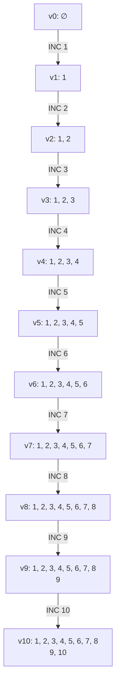

### Cada comando: antes, leitura e depois

| Linha | Comando | Antes (atual) | Efeito / leitura | Depois (atual) |
|---:|---|---|---|---|
| 1 | `INC 1` | v0: ∅ | Insere 1; cria v1. | v1: 1 |
| 2 | `INC 2` | v1: 1 | Insere 2; cria v2. | v2: 1, 2 |
| 3 | `INC 3` | v2: 1, 2 | Insere 3; cria v3. | v3: 1, 2, 3 |
| 4 | `INC 4` | v3: 1, 2, 3 | Insere 4; cria v4. | v4: 1, 2, 3, 4 |
| 5 | `INC 5` | v4: 1, 2, 3, 4 | Insere 5; cria v5. | v5: 1, 2, 3, 4, 5 |
| 6 | `INC 6` | v5: 1, 2, 3, 4, 5 | Insere 6; cria v6. | v6: 1, 2, 3, 4, 5, 6 |
| 7 | `INC 7` | v6: 1, 2, 3, 4, 5, 6 | Insere 7; cria v7. | v7: 1, 2, 3, 4, 5, 6, 7 |
| 8 | `INC 8` | v7: 1, 2, 3, 4, 5, 6, 7 | Insere 8; cria v8. | v8: 1, 2, 3, 4, 5, 6, 7, 8 |
| 9 | `INC 9` | v8: 1, 2, 3, 4, 5, 6, 7, 8 | Insere 9; cria v9. | v9: 1, 2, 3, 4, 5, 6, 7, 8, 9 |
| 10 | `INC 10` | v9: 1, 2, 3, 4, 5, 6, 7, 8, 9 | Insere 10; cria v10. | v10: 1, 2, 3, 4, 5, 6, 7, 8, 9, 10 |
| 11 | `IMP 1` | v10: 1, 2, 3, 4, 5, 6, 7, 8, 9, 10 | Lê v1 [1] ⇒ 1. | v10: 1, 2, 3, 4, 5, 6, 7, 8, 9, 10 |
| 12 | `IMP 2` | v10: 1, 2, 3, 4, 5, 6, 7, 8, 9, 10 | Lê v2 [1, 2] ⇒ 1, 2. | v10: 1, 2, 3, 4, 5, 6, 7, 8, 9, 10 |
| 13 | `IMP 3` | v10: 1, 2, 3, 4, 5, 6, 7, 8, 9, 10 | Lê v3 [1, 2, 3] ⇒ 1, 2, 3. | v10: 1, 2, 3, 4, 5, 6, 7, 8, 9, 10 |
| 14 | `IMP 4` | v10: 1, 2, 3, 4, 5, 6, 7, 8, 9, 10 | Lê v4 [1, 2, 3, 4] ⇒ 1, 2, 3, 4. | v10: 1, 2, 3, 4, 5, 6, 7, 8, 9, 10 |
| 15 | `IMP 5` | v10: 1, 2, 3, 4, 5, 6, 7, 8, 9, 10 | Lê v5 [1, 2, 3, 4, 5] ⇒ 1, 2, 3, 4, 5. | v10: 1, 2, 3, 4, 5, 6, 7, 8, 9, 10 |
| 16 | `IMP 6` | v10: 1, 2, 3, 4, 5, 6, 7, 8, 9, 10 | Lê v6 [1, 2, 3, 4, 5, 6] ⇒ 1, 2, 3, 4, 5, 6. | v10: 1, 2, 3, 4, 5, 6, 7, 8, 9, 10 |
| 17 | `IMP 7` | v10: 1, 2, 3, 4, 5, 6, 7, 8, 9, 10 | Lê v7 [1, 2, 3, 4, 5, 6, 7] ⇒ 1, 2, 3, 4, 5, 6, 7. | v10: 1, 2, 3, 4, 5, 6, 7, 8, 9, 10 |
| 18 | `IMP 8` | v10: 1, 2, 3, 4, 5, 6, 7, 8, 9, 10 | Lê v8 [1, 2, 3, 4, 5, 6, 7, 8] ⇒ 1, 2, 3, 4, 5, 6, 7, 8. | v10: 1, 2, 3, 4, 5, 6, 7, 8, 9, 10 |
| 19 | `IMP 9` | v10: 1, 2, 3, 4, 5, 6, 7, 8, 9, 10 | Lê v9 [1, 2, 3, 4, 5, 6, 7, 8, 9] ⇒ 1, 2, 3, 4, 5, 6, 7, 8, 9. | v10: 1, 2, 3, 4, 5, 6, 7, 8, 9, 10 |
| 20 | `IMP 10` | v10: 1, 2, 3, 4, 5, 6, 7, 8, 9, 10 | Lê v10 [1, 2, 3, 4, 5, 6, 7, 8, 9, 10] ⇒ 1, 2, 3, 4, 5, 6, 7, 8, 9, 10. | v10: 1, 2, 3, 4, 5, 6, 7, 8, 9, 10 |

## Teste 02

Fontes: [`teste02.in`](../testes/teste02.in) e [`teste02.out`](../testes/teste02.out).

Insere 1 e depois 10, então preenche o intervalo com 2 a 9. Verifica inserções no meio da lista e a preservação de cada versão anterior.

### Linha do tempo das versões

Cada seta é um comando de atualização. As consultas estão na tabela abaixo e não geram seta nem versão.

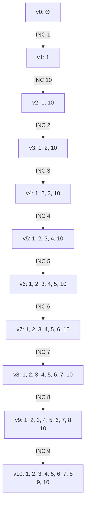

### Cada comando: antes, leitura e depois

| Linha | Comando | Antes (atual) | Efeito / leitura | Depois (atual) |
|---:|---|---|---|---|
| 1 | `INC 1` | v0: ∅ | Insere 1; cria v1. | v1: 1 |
| 2 | `INC 10` | v1: 1 | Insere 10; cria v2. | v2: 1, 10 |
| 3 | `INC 2` | v2: 1, 10 | Insere 2; cria v3. | v3: 1, 2, 10 |
| 4 | `INC 3` | v3: 1, 2, 10 | Insere 3; cria v4. | v4: 1, 2, 3, 10 |
| 5 | `INC 4` | v4: 1, 2, 3, 10 | Insere 4; cria v5. | v5: 1, 2, 3, 4, 10 |
| 6 | `INC 5` | v5: 1, 2, 3, 4, 10 | Insere 5; cria v6. | v6: 1, 2, 3, 4, 5, 10 |
| 7 | `INC 6` | v6: 1, 2, 3, 4, 5, 10 | Insere 6; cria v7. | v7: 1, 2, 3, 4, 5, 6, 10 |
| 8 | `INC 7` | v7: 1, 2, 3, 4, 5, 6, 10 | Insere 7; cria v8. | v8: 1, 2, 3, 4, 5, 6, 7, 10 |
| 9 | `INC 8` | v8: 1, 2, 3, 4, 5, 6, 7, 10 | Insere 8; cria v9. | v9: 1, 2, 3, 4, 5, 6, 7, 8, 10 |
| 10 | `INC 9` | v9: 1, 2, 3, 4, 5, 6, 7, 8, 10 | Insere 9; cria v10. | v10: 1, 2, 3, 4, 5, 6, 7, 8, 9, 10 |
| 11 | `IMP 1` | v10: 1, 2, 3, 4, 5, 6, 7, 8, 9, 10 | Lê v1 [1] ⇒ 1. | v10: 1, 2, 3, 4, 5, 6, 7, 8, 9, 10 |
| 12 | `IMP 2` | v10: 1, 2, 3, 4, 5, 6, 7, 8, 9, 10 | Lê v2 [1, 10] ⇒ 1, 10. | v10: 1, 2, 3, 4, 5, 6, 7, 8, 9, 10 |
| 13 | `IMP 3` | v10: 1, 2, 3, 4, 5, 6, 7, 8, 9, 10 | Lê v3 [1, 2, 10] ⇒ 1, 2, 10. | v10: 1, 2, 3, 4, 5, 6, 7, 8, 9, 10 |
| 14 | `IMP 4` | v10: 1, 2, 3, 4, 5, 6, 7, 8, 9, 10 | Lê v4 [1, 2, 3, 10] ⇒ 1, 2, 3, 10. | v10: 1, 2, 3, 4, 5, 6, 7, 8, 9, 10 |
| 15 | `IMP 5` | v10: 1, 2, 3, 4, 5, 6, 7, 8, 9, 10 | Lê v5 [1, 2, 3, 4, 10] ⇒ 1, 2, 3, 4, 10. | v10: 1, 2, 3, 4, 5, 6, 7, 8, 9, 10 |
| 16 | `IMP 6` | v10: 1, 2, 3, 4, 5, 6, 7, 8, 9, 10 | Lê v6 [1, 2, 3, 4, 5, 10] ⇒ 1, 2, 3, 4, 5, 10. | v10: 1, 2, 3, 4, 5, 6, 7, 8, 9, 10 |
| 17 | `IMP 7` | v10: 1, 2, 3, 4, 5, 6, 7, 8, 9, 10 | Lê v7 [1, 2, 3, 4, 5, 6, 10] ⇒ 1, 2, 3, 4, 5, 6, 10. | v10: 1, 2, 3, 4, 5, 6, 7, 8, 9, 10 |
| 18 | `IMP 8` | v10: 1, 2, 3, 4, 5, 6, 7, 8, 9, 10 | Lê v8 [1, 2, 3, 4, 5, 6, 7, 10] ⇒ 1, 2, 3, 4, 5, 6, 7, 10. | v10: 1, 2, 3, 4, 5, 6, 7, 8, 9, 10 |
| 19 | `IMP 9` | v10: 1, 2, 3, 4, 5, 6, 7, 8, 9, 10 | Lê v9 [1, 2, 3, 4, 5, 6, 7, 8, 10] ⇒ 1, 2, 3, 4, 5, 6, 7, 8, 10. | v10: 1, 2, 3, 4, 5, 6, 7, 8, 9, 10 |
| 20 | `IMP 10` | v10: 1, 2, 3, 4, 5, 6, 7, 8, 9, 10 | Lê v10 [1, 2, 3, 4, 5, 6, 7, 8, 9, 10] ⇒ 1, 2, 3, 4, 5, 6, 7, 8, 9, 10. | v10: 1, 2, 3, 4, 5, 6, 7, 8, 9, 10 |

## Teste 03

Fontes: [`teste03.in`](../testes/teste03.in) e [`teste03.out`](../testes/teste03.out).

Insere 1 e 10, depois 9 a 2 em ordem decrescente. Após formar `v10`, consulta o sucessor de 1 nas versões `v2` a `v10`: a resposta muda de 10 até 2, mesmo sem atualizar a lista durante as consultas.

### Linha do tempo das versões

Cada seta é um comando de atualização. As consultas estão na tabela abaixo e não geram seta nem versão.

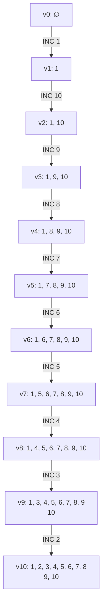

### Cada comando: antes, leitura e depois

| Linha | Comando | Antes (atual) | Efeito / leitura | Depois (atual) |
|---:|---|---|---|---|
| 1 | `INC 1` | v0: ∅ | Insere 1; cria v1. | v1: 1 |
| 2 | `INC 10` | v1: 1 | Insere 10; cria v2. | v2: 1, 10 |
| 3 | `INC 9` | v2: 1, 10 | Insere 9; cria v3. | v3: 1, 9, 10 |
| 4 | `INC 8` | v3: 1, 9, 10 | Insere 8; cria v4. | v4: 1, 8, 9, 10 |
| 5 | `INC 7` | v4: 1, 8, 9, 10 | Insere 7; cria v5. | v5: 1, 7, 8, 9, 10 |
| 6 | `INC 6` | v5: 1, 7, 8, 9, 10 | Insere 6; cria v6. | v6: 1, 6, 7, 8, 9, 10 |
| 7 | `INC 5` | v6: 1, 6, 7, 8, 9, 10 | Insere 5; cria v7. | v7: 1, 5, 6, 7, 8, 9, 10 |
| 8 | `INC 4` | v7: 1, 5, 6, 7, 8, 9, 10 | Insere 4; cria v8. | v8: 1, 4, 5, 6, 7, 8, 9, 10 |
| 9 | `INC 3` | v8: 1, 4, 5, 6, 7, 8, 9, 10 | Insere 3; cria v9. | v9: 1, 3, 4, 5, 6, 7, 8, 9, 10 |
| 10 | `INC 2` | v9: 1, 3, 4, 5, 6, 7, 8, 9, 10 | Insere 2; cria v10. | v10: 1, 2, 3, 4, 5, 6, 7, 8, 9, 10 |
| 11 | `SUC 1 2` | v10: 1, 2, 3, 4, 5, 6, 7, 8, 9, 10 | Lê v2 [1, 10]; primeiro valor > 1 ⇒ 10. | v10: 1, 2, 3, 4, 5, 6, 7, 8, 9, 10 |
| 12 | `SUC 1 3` | v10: 1, 2, 3, 4, 5, 6, 7, 8, 9, 10 | Lê v3 [1, 9, 10]; primeiro valor > 1 ⇒ 9. | v10: 1, 2, 3, 4, 5, 6, 7, 8, 9, 10 |
| 13 | `SUC 1 4` | v10: 1, 2, 3, 4, 5, 6, 7, 8, 9, 10 | Lê v4 [1, 8, 9, 10]; primeiro valor > 1 ⇒ 8. | v10: 1, 2, 3, 4, 5, 6, 7, 8, 9, 10 |
| 14 | `SUC 1 5` | v10: 1, 2, 3, 4, 5, 6, 7, 8, 9, 10 | Lê v5 [1, 7, 8, 9, 10]; primeiro valor > 1 ⇒ 7. | v10: 1, 2, 3, 4, 5, 6, 7, 8, 9, 10 |
| 15 | `SUC 1 6` | v10: 1, 2, 3, 4, 5, 6, 7, 8, 9, 10 | Lê v6 [1, 6, 7, 8, 9, 10]; primeiro valor > 1 ⇒ 6. | v10: 1, 2, 3, 4, 5, 6, 7, 8, 9, 10 |
| 16 | `SUC 1 7` | v10: 1, 2, 3, 4, 5, 6, 7, 8, 9, 10 | Lê v7 [1, 5, 6, 7, 8, 9, 10]; primeiro valor > 1 ⇒ 5. | v10: 1, 2, 3, 4, 5, 6, 7, 8, 9, 10 |
| 17 | `SUC 1 8` | v10: 1, 2, 3, 4, 5, 6, 7, 8, 9, 10 | Lê v8 [1, 4, 5, 6, 7, 8, 9, 10]; primeiro valor > 1 ⇒ 4. | v10: 1, 2, 3, 4, 5, 6, 7, 8, 9, 10 |
| 18 | `SUC 1 9` | v10: 1, 2, 3, 4, 5, 6, 7, 8, 9, 10 | Lê v9 [1, 3, 4, 5, 6, 7, 8, 9, 10]; primeiro valor > 1 ⇒ 3. | v10: 1, 2, 3, 4, 5, 6, 7, 8, 9, 10 |
| 19 | `SUC 1 10` | v10: 1, 2, 3, 4, 5, 6, 7, 8, 9, 10 | Lê v10 [1, 2, 3, 4, 5, 6, 7, 8, 9, 10]; primeiro valor > 1 ⇒ 2. | v10: 1, 2, 3, 4, 5, 6, 7, 8, 9, 10 |
| 20 | `IMP 10` | v10: 1, 2, 3, 4, 5, 6, 7, 8, 9, 10 | Lê v10 [1, 2, 3, 4, 5, 6, 7, 8, 9, 10] ⇒ 1, 2, 3, 4, 5, 6, 7, 8, 9, 10. | v10: 1, 2, 3, 4, 5, 6, 7, 8, 9, 10 |

## Teste 04

Fontes: [`teste04.in`](../testes/teste04.in) e [`teste04.out`](../testes/teste04.out).

Insere 10 a 1, depois remove os pares 2, 4, 6, 8 e 10. `v15` contém só ímpares. `SUC 1 10` ainda vê o 2; `SUC 1 11` já vê o 3.

### Linha do tempo das versões

Cada seta é um comando de atualização. As consultas estão na tabela abaixo e não geram seta nem versão.

**Versões v0 a v10**

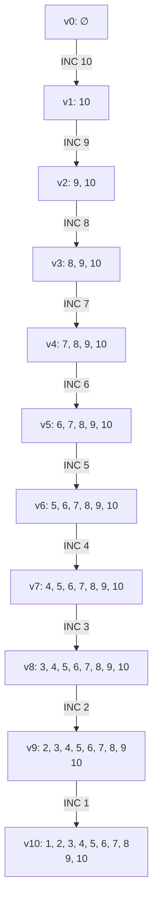

**Versões v10 a v15**

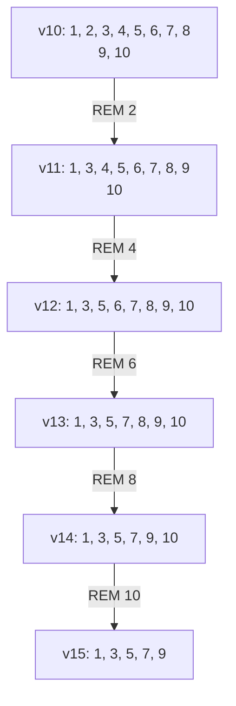

### Cada comando: antes, leitura e depois

| Linha | Comando | Antes (atual) | Efeito / leitura | Depois (atual) |
|---:|---|---|---|---|
| 1 | `INC 10` | v0: ∅ | Insere 10; cria v1. | v1: 10 |
| 2 | `INC 9` | v1: 10 | Insere 9; cria v2. | v2: 9, 10 |
| 3 | `INC 8` | v2: 9, 10 | Insere 8; cria v3. | v3: 8, 9, 10 |
| 4 | `INC 7` | v3: 8, 9, 10 | Insere 7; cria v4. | v4: 7, 8, 9, 10 |
| 5 | `INC 6` | v4: 7, 8, 9, 10 | Insere 6; cria v5. | v5: 6, 7, 8, 9, 10 |
| 6 | `INC 5` | v5: 6, 7, 8, 9, 10 | Insere 5; cria v6. | v6: 5, 6, 7, 8, 9, 10 |
| 7 | `INC 4` | v6: 5, 6, 7, 8, 9, 10 | Insere 4; cria v7. | v7: 4, 5, 6, 7, 8, 9, 10 |
| 8 | `INC 3` | v7: 4, 5, 6, 7, 8, 9, 10 | Insere 3; cria v8. | v8: 3, 4, 5, 6, 7, 8, 9, 10 |
| 9 | `INC 2` | v8: 3, 4, 5, 6, 7, 8, 9, 10 | Insere 2; cria v9. | v9: 2, 3, 4, 5, 6, 7, 8, 9, 10 |
| 10 | `INC 1` | v9: 2, 3, 4, 5, 6, 7, 8, 9, 10 | Insere 1; cria v10. | v10: 1, 2, 3, 4, 5, 6, 7, 8, 9, 10 |
| 11 | `REM 2` | v10: 1, 2, 3, 4, 5, 6, 7, 8, 9, 10 | Remove uma ocorrência de 2; cria v11. | v11: 1, 3, 4, 5, 6, 7, 8, 9, 10 |
| 12 | `REM 4` | v11: 1, 3, 4, 5, 6, 7, 8, 9, 10 | Remove uma ocorrência de 4; cria v12. | v12: 1, 3, 5, 6, 7, 8, 9, 10 |
| 13 | `REM 6` | v12: 1, 3, 5, 6, 7, 8, 9, 10 | Remove uma ocorrência de 6; cria v13. | v13: 1, 3, 5, 7, 8, 9, 10 |
| 14 | `REM 8` | v13: 1, 3, 5, 7, 8, 9, 10 | Remove uma ocorrência de 8; cria v14. | v14: 1, 3, 5, 7, 9, 10 |
| 15 | `REM 10` | v14: 1, 3, 5, 7, 9, 10 | Remove uma ocorrência de 10; cria v15. | v15: 1, 3, 5, 7, 9 |
| 16 | `IMP 15` | v15: 1, 3, 5, 7, 9 | Lê v15 [1, 3, 5, 7, 9] ⇒ 1, 3, 5, 7, 9. | v15: 1, 3, 5, 7, 9 |
| 17 | `SUC 1 10` | v15: 1, 3, 5, 7, 9 | Lê v10 [1, 2, 3, 4, 5, 6, 7, 8, 9, 10]; primeiro valor > 1 ⇒ 2. | v15: 1, 3, 5, 7, 9 |
| 18 | `SUC 1 11` | v15: 1, 3, 5, 7, 9 | Lê v11 [1, 3, 4, 5, 6, 7, 8, 9, 10]; primeiro valor > 1 ⇒ 3. | v15: 1, 3, 5, 7, 9 |

### Exemplo físico: remoção de 2 em v11

Na linha 11, `REM 2` faz `v10 = 1 → 2 → 3 → …` virar `v11 = 1 → 3 → …`. Como o nó de chave 1 ainda dispõe de registro de modificação, as duas cabeças apontam para **o mesmo nó 1**. A leitura versionada escolhe o elo antigo para `v10` e o novo para `v11`; o nó 2 continua acessível pela versão antiga.

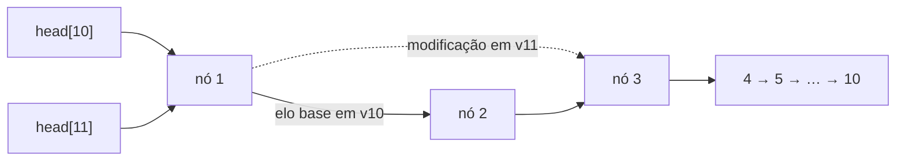

## Teste 05

Fontes: [`teste05.in`](../testes/teste05.in) e [`teste05.out`](../testes/teste05.out).

Mistura inserções, remoções presentes e ausentes, `IMP` e `SUC` históricos. Confere a versão 0 vazia, consultas intercaladas sem nova versão e `IMP 99` com retorno à última versão. Há 54 atualizações, das quais 32 são remoções ausentes: o conteúdo não muda nesses passos, mas o número da versão aumenta.

### Linha do tempo das versões

Cada seta é um comando de atualização. As consultas estão na tabela abaixo e não geram seta nem versão.

**Versões v0 a v10**

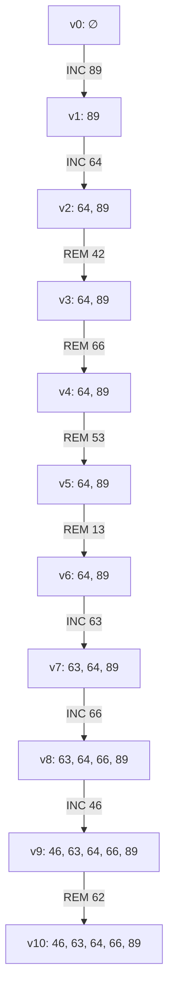

**Versões v10 a v20**

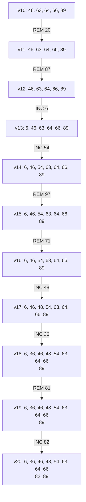

**Versões v20 a v30**

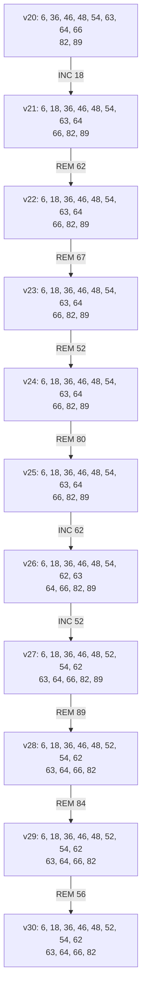

**Versões v30 a v40**

```mermaid
flowchart TB
    v30["v30: 6, 18, 36, 46, 48, 52, 54, 62<br/>63, 64, 66, 82"] -->|"INC 45"| v31["v31: 6, 18, 36, 45, 46, 48, 52, 54<br/>62, 63, 64, 66, 82"]
    v31["v31: 6, 18, 36, 45, 46, 48, 52, 54<br/>62, 63, 64, 66, 82"] -->|"REM 97"| v32["v32: 6, 18, 36, 45, 46, 48, 52, 54<br/>62, 63, 64, 66, 82"]
    v32["v32: 6, 18, 36, 45, 46, 48, 52, 54<br/>62, 63, 64, 66, 82"] -->|"REM 18"| v33["v33: 6, 36, 45, 46, 48, 52, 54, 62<br/>63, 64, 66, 82"]
    v33["v33: 6, 36, 45, 46, 48, 52, 54, 62<br/>63, 64, 66, 82"] -->|"INC 65"| v34["v34: 6, 36, 45, 46, 48, 52, 54, 62<br/>63, 64, 65, 66, 82"]
    v34["v34: 6, 36, 45, 46, 48, 52, 54, 62<br/>63, 64, 65, 66, 82"] -->|"REM 30"| v35["v35: 6, 36, 45, 46, 48, 52, 54, 62<br/>63, 64, 65, 66, 82"]
    v35["v35: 6, 36, 45, 46, 48, 52, 54, 62<br/>63, 64, 65, 66, 82"] -->|"REM 8"| v36["v36: 6, 36, 45, 46, 48, 52, 54, 62<br/>63, 64, 65, 66, 82"]
    v36["v36: 6, 36, 45, 46, 48, 52, 54, 62<br/>63, 64, 65, 66, 82"] -->|"INC 51"| v37["v37: 6, 36, 45, 46, 48, 51, 52, 54<br/>62, 63, 64, 65, 66, 82"]
    v37["v37: 6, 36, 45, 46, 48, 51, 52, 54<br/>62, 63, 64, 65, 66, 82"] -->|"REM 79"| v38["v38: 6, 36, 45, 46, 48, 51, 52, 54<br/>62, 63, 64, 65, 66, 82"]
    v38["v38: 6, 36, 45, 46, 48, 51, 52, 54<br/>62, 63, 64, 65, 66, 82"] -->|"REM 78"| v39["v39: 6, 36, 45, 46, 48, 51, 52, 54<br/>62, 63, 64, 65, 66, 82"]
    v39["v39: 6, 36, 45, 46, 48, 51, 52, 54<br/>62, 63, 64, 65, 66, 82"] -->|"REM 28"| v40["v40: 6, 36, 45, 46, 48, 51, 52, 54<br/>62, 63, 64, 65, 66, 82"]
```

**Versões v40 a v50**

```mermaid
flowchart TB
    v40["v40: 6, 36, 45, 46, 48, 51, 52, 54<br/>62, 63, 64, 65, 66, 82"] -->|"REM 5"| v41["v41: 6, 36, 45, 46, 48, 51, 52, 54<br/>62, 63, 64, 65, 66, 82"]
    v41["v41: 6, 36, 45, 46, 48, 51, 52, 54<br/>62, 63, 64, 65, 66, 82"] -->|"INC 21"| v42["v42: 6, 21, 36, 45, 46, 48, 51, 52<br/>54, 62, 63, 64, 65, 66, 82"]
    v42["v42: 6, 21, 36, 45, 46, 48, 51, 52<br/>54, 62, 63, 64, 65, 66, 82"] -->|"REM 97"| v43["v43: 6, 21, 36, 45, 46, 48, 51, 52<br/>54, 62, 63, 64, 65, 66, 82"]
    v43["v43: 6, 21, 36, 45, 46, 48, 51, 52<br/>54, 62, 63, 64, 65, 66, 82"] -->|"REM 31"| v44["v44: 6, 21, 36, 45, 46, 48, 51, 52<br/>54, 62, 63, 64, 65, 66, 82"]
    v44["v44: 6, 21, 36, 45, 46, 48, 51, 52<br/>54, 62, 63, 64, 65, 66, 82"] -->|"REM 47"| v45["v45: 6, 21, 36, 45, 46, 48, 51, 52<br/>54, 62, 63, 64, 65, 66, 82"]
    v45["v45: 6, 21, 36, 45, 46, 48, 51, 52<br/>54, 62, 63, 64, 65, 66, 82"] -->|"REM 30"| v46["v46: 6, 21, 36, 45, 46, 48, 51, 52<br/>54, 62, 63, 64, 65, 66, 82"]
    v46["v46: 6, 21, 36, 45, 46, 48, 51, 52<br/>54, 62, 63, 64, 65, 66, 82"] -->|"REM 14"| v47["v47: 6, 21, 36, 45, 46, 48, 51, 52<br/>54, 62, 63, 64, 65, 66, 82"]
    v47["v47: 6, 21, 36, 45, 46, 48, 51, 52<br/>54, 62, 63, 64, 65, 66, 82"] -->|"REM 93"| v48["v48: 6, 21, 36, 45, 46, 48, 51, 52<br/>54, 62, 63, 64, 65, 66, 82"]
    v48["v48: 6, 21, 36, 45, 46, 48, 51, 52<br/>54, 62, 63, 64, 65, 66, 82"] -->|"INC 38"| v49["v49: 6, 21, 36, 38, 45, 46, 48, 51<br/>52, 54, 62, 63, 64, 65, 66, 82"]
    v49["v49: 6, 21, 36, 38, 45, 46, 48, 51<br/>52, 54, 62, 63, 64, 65, 66, 82"] -->|"REM 97"| v50["v50: 6, 21, 36, 38, 45, 46, 48, 51<br/>52, 54, 62, 63, 64, 65, 66, 82"]
```

**Versões v50 a v54**

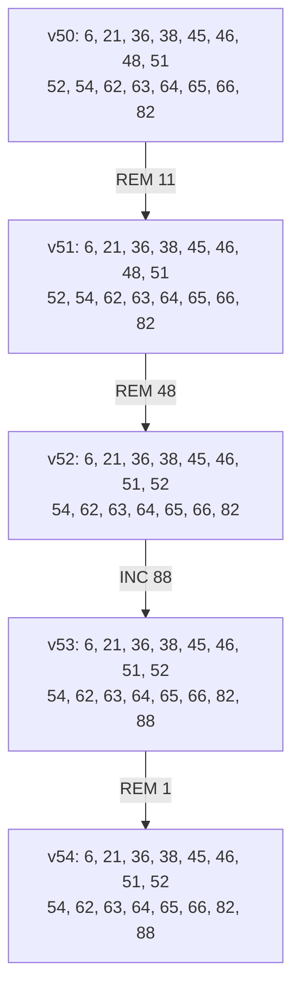

### Cada comando: antes, leitura e depois

| Linha | Comando | Antes (atual) | Efeito / leitura | Depois (atual) |
|---:|---|---|---|---|
| 1 | `INC 89` | v0: ∅ | Insere 89; cria v1. | v1: 89 |
| 2 | `INC 64` | v1: 89 | Insere 64; cria v2. | v2: 64, 89 |
| 3 | `REM 42` | v2: 64, 89 | 42 ausente; cria v3 com o mesmo conteúdo. | v3: 64, 89 |
| 4 | `IMP 1` | v3: 64, 89 | Lê v1 [89] ⇒ 89. | v3: 64, 89 |
| 5 | `SUC 97 2` | v3: 64, 89 | Lê v2 [64, 89]; primeiro valor > 97 ⇒ inf. | v3: 64, 89 |
| 6 | `REM 66` | v3: 64, 89 | 66 ausente; cria v4 com o mesmo conteúdo. | v4: 64, 89 |
| 7 | `REM 53` | v4: 64, 89 | 53 ausente; cria v5 com o mesmo conteúdo. | v5: 64, 89 |
| 8 | `IMP 1` | v5: 64, 89 | Lê v1 [89] ⇒ 89. | v5: 64, 89 |
| 9 | `REM 13` | v5: 64, 89 | 13 ausente; cria v6 com o mesmo conteúdo. | v6: 64, 89 |
| 10 | `INC 63` | v6: 64, 89 | Insere 63; cria v7. | v7: 63, 64, 89 |
| 11 | `IMP 2` | v7: 63, 64, 89 | Lê v2 [64, 89] ⇒ 64, 89. | v7: 63, 64, 89 |
| 12 | `SUC 78 3` | v7: 63, 64, 89 | Lê v3 [64, 89]; primeiro valor > 78 ⇒ 89. | v7: 63, 64, 89 |
| 13 | `SUC 98 0` | v7: 63, 64, 89 | Lê v0 [∅]; primeiro valor > 98 ⇒ inf. | v7: 63, 64, 89 |
| 14 | `SUC 74 3` | v7: 63, 64, 89 | Lê v3 [64, 89]; primeiro valor > 74 ⇒ 89. | v7: 63, 64, 89 |
| 15 | `INC 66` | v7: 63, 64, 89 | Insere 66; cria v8. | v8: 63, 64, 66, 89 |
| 16 | `INC 46` | v8: 63, 64, 66, 89 | Insere 46; cria v9. | v9: 46, 63, 64, 66, 89 |
| 17 | `REM 62` | v9: 46, 63, 64, 66, 89 | 62 ausente; cria v10 com o mesmo conteúdo. | v10: 46, 63, 64, 66, 89 |
| 18 | `REM 20` | v10: 46, 63, 64, 66, 89 | 20 ausente; cria v11 com o mesmo conteúdo. | v11: 46, 63, 64, 66, 89 |
| 19 | `IMP 4` | v11: 46, 63, 64, 66, 89 | Lê v4 [64, 89] ⇒ 64, 89. | v11: 46, 63, 64, 66, 89 |
| 20 | `REM 87` | v11: 46, 63, 64, 66, 89 | 87 ausente; cria v12 com o mesmo conteúdo. | v12: 46, 63, 64, 66, 89 |
| 21 | `INC 6` | v12: 46, 63, 64, 66, 89 | Insere 6; cria v13. | v13: 6, 46, 63, 64, 66, 89 |
| 22 | `INC 54` | v13: 6, 46, 63, 64, 66, 89 | Insere 54; cria v14. | v14: 6, 46, 54, 63, 64, 66, 89 |
| 23 | `IMP 10` | v14: 6, 46, 54, 63, 64, 66, 89 | Lê v10 [46, 63, 64, 66, 89] ⇒ 46, 63, 64, 66, 89. | v14: 6, 46, 54, 63, 64, 66, 89 |
| 24 | `REM 97` | v14: 6, 46, 54, 63, 64, 66, 89 | 97 ausente; cria v15 com o mesmo conteúdo. | v15: 6, 46, 54, 63, 64, 66, 89 |
| 25 | `REM 71` | v15: 6, 46, 54, 63, 64, 66, 89 | 71 ausente; cria v16 com o mesmo conteúdo. | v16: 6, 46, 54, 63, 64, 66, 89 |
| 26 | `INC 48` | v16: 6, 46, 54, 63, 64, 66, 89 | Insere 48; cria v17. | v17: 6, 46, 48, 54, 63, 64, 66, 89 |
| 27 | `IMP 0` | v17: 6, 46, 48, 54, 63, 64, 66, 89 | Lê v0 [∅] ⇒ linha vazia. | v17: 6, 46, 48, 54, 63, 64, 66, 89 |
| 28 | `IMP 0` | v17: 6, 46, 48, 54, 63, 64, 66, 89 | Lê v0 [∅] ⇒ linha vazia. | v17: 6, 46, 48, 54, 63, 64, 66, 89 |
| 29 | `IMP 12` | v17: 6, 46, 48, 54, 63, 64, 66, 89 | Lê v12 [46, 63, 64, 66, 89] ⇒ 46, 63, 64, 66, 89. | v17: 6, 46, 48, 54, 63, 64, 66, 89 |
| 30 | `INC 36` | v17: 6, 46, 48, 54, 63, 64, 66, 89 | Insere 36; cria v18. | v18: 6, 36, 46, 48, 54, 63, 64, 66, 89 |
| 31 | `REM 81` | v18: 6, 36, 46, 48, 54, 63, 64, 66, 89 | 81 ausente; cria v19 com o mesmo conteúdo. | v19: 6, 36, 46, 48, 54, 63, 64, 66, 89 |
| 32 | `SUC 59 0` | v19: 6, 36, 46, 48, 54, 63, 64, 66, 89 | Lê v0 [∅]; primeiro valor > 59 ⇒ inf. | v19: 6, 36, 46, 48, 54, 63, 64, 66, 89 |
| 33 | `INC 82` | v19: 6, 36, 46, 48, 54, 63, 64, 66, 89 | Insere 82; cria v20. | v20: 6, 36, 46, 48, 54, 63, 64, 66, 82, 89 |
| 34 | `SUC 96 1` | v20: 6, 36, 46, 48, 54, 63, 64, 66, 82, 89 | Lê v1 [89]; primeiro valor > 96 ⇒ inf. | v20: 6, 36, 46, 48, 54, 63, 64, 66, 82, 89 |
| 35 | `INC 18` | v20: 6, 36, 46, 48, 54, 63, 64, 66, 82, 89 | Insere 18; cria v21. | v21: 6, 18, 36, 46, 48, 54, 63, 64, 66, 82, 89 |
| 36 | `IMP 0` | v21: 6, 18, 36, 46, 48, 54, 63, 64, 66, 82, 89 | Lê v0 [∅] ⇒ linha vazia. | v21: 6, 18, 36, 46, 48, 54, 63, 64, 66, 82, 89 |
| 37 | `REM 62` | v21: 6, 18, 36, 46, 48, 54, 63, 64, 66, 82, 89 | 62 ausente; cria v22 com o mesmo conteúdo. | v22: 6, 18, 36, 46, 48, 54, 63, 64, 66, 82, 89 |
| 38 | `REM 67` | v22: 6, 18, 36, 46, 48, 54, 63, 64, 66, 82, 89 | 67 ausente; cria v23 com o mesmo conteúdo. | v23: 6, 18, 36, 46, 48, 54, 63, 64, 66, 82, 89 |
| 39 | `REM 52` | v23: 6, 18, 36, 46, 48, 54, 63, 64, 66, 82, 89 | 52 ausente; cria v24 com o mesmo conteúdo. | v24: 6, 18, 36, 46, 48, 54, 63, 64, 66, 82, 89 |
| 40 | `REM 80` | v24: 6, 18, 36, 46, 48, 54, 63, 64, 66, 82, 89 | 80 ausente; cria v25 com o mesmo conteúdo. | v25: 6, 18, 36, 46, 48, 54, 63, 64, 66, 82, 89 |
| 41 | `INC 62` | v25: 6, 18, 36, 46, 48, 54, 63, 64, 66, 82, 89 | Insere 62; cria v26. | v26: 6, 18, 36, 46, 48, 54, 62, 63, 64, 66, 82, 89 |
| 42 | `INC 52` | v26: 6, 18, 36, 46, 48, 54, 62, 63, 64, 66, 82, 89 | Insere 52; cria v27. | v27: 6, 18, 36, 46, 48, 52, 54, 62, 63, 64, 66, 82, 89 |
| 43 | `IMP 10` | v27: 6, 18, 36, 46, 48, 52, 54, 62, 63, 64, 66, 82, 89 | Lê v10 [46, 63, 64, 66, 89] ⇒ 46, 63, 64, 66, 89. | v27: 6, 18, 36, 46, 48, 52, 54, 62, 63, 64, 66, 82, 89 |
| 44 | `IMP 11` | v27: 6, 18, 36, 46, 48, 52, 54, 62, 63, 64, 66, 82, 89 | Lê v11 [46, 63, 64, 66, 89] ⇒ 46, 63, 64, 66, 89. | v27: 6, 18, 36, 46, 48, 52, 54, 62, 63, 64, 66, 82, 89 |
| 45 | `SUC 52 4` | v27: 6, 18, 36, 46, 48, 52, 54, 62, 63, 64, 66, 82, 89 | Lê v4 [64, 89]; primeiro valor > 52 ⇒ 64. | v27: 6, 18, 36, 46, 48, 52, 54, 62, 63, 64, 66, 82, 89 |
| 46 | `REM 89` | v27: 6, 18, 36, 46, 48, 52, 54, 62, 63, 64, 66, 82, 89 | Remove uma ocorrência de 89; cria v28. | v28: 6, 18, 36, 46, 48, 52, 54, 62, 63, 64, 66, 82 |
| 47 | `IMP 2` | v28: 6, 18, 36, 46, 48, 52, 54, 62, 63, 64, 66, 82 | Lê v2 [64, 89] ⇒ 64, 89. | v28: 6, 18, 36, 46, 48, 52, 54, 62, 63, 64, 66, 82 |
| 48 | `REM 84` | v28: 6, 18, 36, 46, 48, 52, 54, 62, 63, 64, 66, 82 | 84 ausente; cria v29 com o mesmo conteúdo. | v29: 6, 18, 36, 46, 48, 52, 54, 62, 63, 64, 66, 82 |
| 49 | `REM 56` | v29: 6, 18, 36, 46, 48, 52, 54, 62, 63, 64, 66, 82 | 56 ausente; cria v30 com o mesmo conteúdo. | v30: 6, 18, 36, 46, 48, 52, 54, 62, 63, 64, 66, 82 |
| 50 | `SUC 57 20` | v30: 6, 18, 36, 46, 48, 52, 54, 62, 63, 64, 66, 82 | Lê v20 [6, 36, 46, 48, 54, 63, 64, 66, 82, 89]; primeiro valor > 57 ⇒ 63. | v30: 6, 18, 36, 46, 48, 52, 54, 62, 63, 64, 66, 82 |
| 51 | `SUC 39 13` | v30: 6, 18, 36, 46, 48, 52, 54, 62, 63, 64, 66, 82 | Lê v13 [6, 46, 63, 64, 66, 89]; primeiro valor > 39 ⇒ 46. | v30: 6, 18, 36, 46, 48, 52, 54, 62, 63, 64, 66, 82 |
| 52 | `INC 45` | v30: 6, 18, 36, 46, 48, 52, 54, 62, 63, 64, 66, 82 | Insere 45; cria v31. | v31: 6, 18, 36, 45, 46, 48, 52, 54, 62, 63, 64, 66, 82 |
| 53 | `IMP 12` | v31: 6, 18, 36, 45, 46, 48, 52, 54, 62, 63, 64, 66, 82 | Lê v12 [46, 63, 64, 66, 89] ⇒ 46, 63, 64, 66, 89. | v31: 6, 18, 36, 45, 46, 48, 52, 54, 62, 63, 64, 66, 82 |
| 54 | `SUC 20 26` | v31: 6, 18, 36, 45, 46, 48, 52, 54, 62, 63, 64, 66, 82 | Lê v26 [6, 18, 36, 46, 48, 54, 62, 63, 64, 66, 82, 89]; primeiro valor > 20 ⇒ 36. | v31: 6, 18, 36, 45, 46, 48, 52, 54, 62, 63, 64, 66, 82 |
| 55 | `REM 97` | v31: 6, 18, 36, 45, 46, 48, 52, 54, 62, 63, 64, 66, 82 | 97 ausente; cria v32 com o mesmo conteúdo. | v32: 6, 18, 36, 45, 46, 48, 52, 54, 62, 63, 64, 66, 82 |
| 56 | `REM 18` | v32: 6, 18, 36, 45, 46, 48, 52, 54, 62, 63, 64, 66, 82 | Remove uma ocorrência de 18; cria v33. | v33: 6, 36, 45, 46, 48, 52, 54, 62, 63, 64, 66, 82 |
| 57 | `INC 65` | v33: 6, 36, 45, 46, 48, 52, 54, 62, 63, 64, 66, 82 | Insere 65; cria v34. | v34: 6, 36, 45, 46, 48, 52, 54, 62, 63, 64, 65, 66, 82 |
| 58 | `REM 30` | v34: 6, 36, 45, 46, 48, 52, 54, 62, 63, 64, 65, 66, 82 | 30 ausente; cria v35 com o mesmo conteúdo. | v35: 6, 36, 45, 46, 48, 52, 54, 62, 63, 64, 65, 66, 82 |
| 59 | `REM 8` | v35: 6, 36, 45, 46, 48, 52, 54, 62, 63, 64, 65, 66, 82 | 8 ausente; cria v36 com o mesmo conteúdo. | v36: 6, 36, 45, 46, 48, 52, 54, 62, 63, 64, 65, 66, 82 |
| 60 | `INC 51` | v36: 6, 36, 45, 46, 48, 52, 54, 62, 63, 64, 65, 66, 82 | Insere 51; cria v37. | v37: 6, 36, 45, 46, 48, 51, 52, 54, 62, 63, 64, 65, 66, 82 |
| 61 | `REM 79` | v37: 6, 36, 45, 46, 48, 51, 52, 54, 62, 63, 64, 65, 66, 82 | 79 ausente; cria v38 com o mesmo conteúdo. | v38: 6, 36, 45, 46, 48, 51, 52, 54, 62, 63, 64, 65, 66, 82 |
| 62 | `SUC 28 18` | v38: 6, 36, 45, 46, 48, 51, 52, 54, 62, 63, 64, 65, 66, 82 | Lê v18 [6, 36, 46, 48, 54, 63, 64, 66, 89]; primeiro valor > 28 ⇒ 36. | v38: 6, 36, 45, 46, 48, 51, 52, 54, 62, 63, 64, 65, 66, 82 |
| 63 | `SUC 39 24` | v38: 6, 36, 45, 46, 48, 51, 52, 54, 62, 63, 64, 65, 66, 82 | Lê v24 [6, 18, 36, 46, 48, 54, 63, 64, 66, 82, 89]; primeiro valor > 39 ⇒ 46. | v38: 6, 36, 45, 46, 48, 51, 52, 54, 62, 63, 64, 65, 66, 82 |
| 64 | `SUC 99 2` | v38: 6, 36, 45, 46, 48, 51, 52, 54, 62, 63, 64, 65, 66, 82 | Lê v2 [64, 89]; primeiro valor > 99 ⇒ inf. | v38: 6, 36, 45, 46, 48, 51, 52, 54, 62, 63, 64, 65, 66, 82 |
| 65 | `SUC 45 9` | v38: 6, 36, 45, 46, 48, 51, 52, 54, 62, 63, 64, 65, 66, 82 | Lê v9 [46, 63, 64, 66, 89]; primeiro valor > 45 ⇒ 46. | v38: 6, 36, 45, 46, 48, 51, 52, 54, 62, 63, 64, 65, 66, 82 |
| 66 | `SUC 75 31` | v38: 6, 36, 45, 46, 48, 51, 52, 54, 62, 63, 64, 65, 66, 82 | Lê v31 [6, 18, 36, 45, 46, 48, 52, 54, 62, 63, 64, 66, 82]; primeiro valor > 75 ⇒ 82. | v38: 6, 36, 45, 46, 48, 51, 52, 54, 62, 63, 64, 65, 66, 82 |
| 67 | `REM 78` | v38: 6, 36, 45, 46, 48, 51, 52, 54, 62, 63, 64, 65, 66, 82 | 78 ausente; cria v39 com o mesmo conteúdo. | v39: 6, 36, 45, 46, 48, 51, 52, 54, 62, 63, 64, 65, 66, 82 |
| 68 | `REM 28` | v39: 6, 36, 45, 46, 48, 51, 52, 54, 62, 63, 64, 65, 66, 82 | 28 ausente; cria v40 com o mesmo conteúdo. | v40: 6, 36, 45, 46, 48, 51, 52, 54, 62, 63, 64, 65, 66, 82 |
| 69 | `SUC 60 2` | v40: 6, 36, 45, 46, 48, 51, 52, 54, 62, 63, 64, 65, 66, 82 | Lê v2 [64, 89]; primeiro valor > 60 ⇒ 64. | v40: 6, 36, 45, 46, 48, 51, 52, 54, 62, 63, 64, 65, 66, 82 |
| 70 | `REM 5` | v40: 6, 36, 45, 46, 48, 51, 52, 54, 62, 63, 64, 65, 66, 82 | 5 ausente; cria v41 com o mesmo conteúdo. | v41: 6, 36, 45, 46, 48, 51, 52, 54, 62, 63, 64, 65, 66, 82 |
| 71 | `INC 21` | v41: 6, 36, 45, 46, 48, 51, 52, 54, 62, 63, 64, 65, 66, 82 | Insere 21; cria v42. | v42: 6, 21, 36, 45, 46, 48, 51, 52, 54, 62, 63, 64, 65, 66, 82 |
| 72 | `IMP 18` | v42: 6, 21, 36, 45, 46, 48, 51, 52, 54, 62, 63, 64, 65, 66, 82 | Lê v18 [6, 36, 46, 48, 54, 63, 64, 66, 89] ⇒ 6, 36, 46, 48, 54, 63, 64, 66, 89. | v42: 6, 21, 36, 45, 46, 48, 51, 52, 54, 62, 63, 64, 65, 66, 82 |
| 73 | `REM 97` | v42: 6, 21, 36, 45, 46, 48, 51, 52, 54, 62, 63, 64, 65, 66, 82 | 97 ausente; cria v43 com o mesmo conteúdo. | v43: 6, 21, 36, 45, 46, 48, 51, 52, 54, 62, 63, 64, 65, 66, 82 |
| 74 | `REM 31` | v43: 6, 21, 36, 45, 46, 48, 51, 52, 54, 62, 63, 64, 65, 66, 82 | 31 ausente; cria v44 com o mesmo conteúdo. | v44: 6, 21, 36, 45, 46, 48, 51, 52, 54, 62, 63, 64, 65, 66, 82 |
| 75 | `REM 47` | v44: 6, 21, 36, 45, 46, 48, 51, 52, 54, 62, 63, 64, 65, 66, 82 | 47 ausente; cria v45 com o mesmo conteúdo. | v45: 6, 21, 36, 45, 46, 48, 51, 52, 54, 62, 63, 64, 65, 66, 82 |
| 76 | `REM 30` | v45: 6, 21, 36, 45, 46, 48, 51, 52, 54, 62, 63, 64, 65, 66, 82 | 30 ausente; cria v46 com o mesmo conteúdo. | v46: 6, 21, 36, 45, 46, 48, 51, 52, 54, 62, 63, 64, 65, 66, 82 |
| 77 | `IMP 10` | v46: 6, 21, 36, 45, 46, 48, 51, 52, 54, 62, 63, 64, 65, 66, 82 | Lê v10 [46, 63, 64, 66, 89] ⇒ 46, 63, 64, 66, 89. | v46: 6, 21, 36, 45, 46, 48, 51, 52, 54, 62, 63, 64, 65, 66, 82 |
| 78 | `REM 14` | v46: 6, 21, 36, 45, 46, 48, 51, 52, 54, 62, 63, 64, 65, 66, 82 | 14 ausente; cria v47 com o mesmo conteúdo. | v47: 6, 21, 36, 45, 46, 48, 51, 52, 54, 62, 63, 64, 65, 66, 82 |
| 79 | `REM 93` | v47: 6, 21, 36, 45, 46, 48, 51, 52, 54, 62, 63, 64, 65, 66, 82 | 93 ausente; cria v48 com o mesmo conteúdo. | v48: 6, 21, 36, 45, 46, 48, 51, 52, 54, 62, 63, 64, 65, 66, 82 |
| 80 | `SUC 19 36` | v48: 6, 21, 36, 45, 46, 48, 51, 52, 54, 62, 63, 64, 65, 66, 82 | Lê v36 [6, 36, 45, 46, 48, 52, 54, 62, 63, 64, 65, 66, 82]; primeiro valor > 19 ⇒ 36. | v48: 6, 21, 36, 45, 46, 48, 51, 52, 54, 62, 63, 64, 65, 66, 82 |
| 81 | `IMP 13` | v48: 6, 21, 36, 45, 46, 48, 51, 52, 54, 62, 63, 64, 65, 66, 82 | Lê v13 [6, 46, 63, 64, 66, 89] ⇒ 6, 46, 63, 64, 66, 89. | v48: 6, 21, 36, 45, 46, 48, 51, 52, 54, 62, 63, 64, 65, 66, 82 |
| 82 | `INC 38` | v48: 6, 21, 36, 45, 46, 48, 51, 52, 54, 62, 63, 64, 65, 66, 82 | Insere 38; cria v49. | v49: 6, 21, 36, 38, 45, 46, 48, 51, 52, 54, 62, 63, 64, 65, 66, 82 |
| 83 | `REM 97` | v49: 6, 21, 36, 38, 45, 46, 48, 51, 52, 54, 62, 63, 64, 65, 66, 82 | 97 ausente; cria v50 com o mesmo conteúdo. | v50: 6, 21, 36, 38, 45, 46, 48, 51, 52, 54, 62, 63, 64, 65, 66, 82 |
| 84 | `REM 11` | v50: 6, 21, 36, 38, 45, 46, 48, 51, 52, 54, 62, 63, 64, 65, 66, 82 | 11 ausente; cria v51 com o mesmo conteúdo. | v51: 6, 21, 36, 38, 45, 46, 48, 51, 52, 54, 62, 63, 64, 65, 66, 82 |
| 85 | `IMP 4` | v51: 6, 21, 36, 38, 45, 46, 48, 51, 52, 54, 62, 63, 64, 65, 66, 82 | Lê v4 [64, 89] ⇒ 64, 89. | v51: 6, 21, 36, 38, 45, 46, 48, 51, 52, 54, 62, 63, 64, 65, 66, 82 |
| 86 | `IMP 37` | v51: 6, 21, 36, 38, 45, 46, 48, 51, 52, 54, 62, 63, 64, 65, 66, 82 | Lê v37 [6, 36, 45, 46, 48, 51, 52, 54, 62, 63, 64, 65, 66, 82] ⇒ 6, 36, 45, 46, 48, 51, 52, 54, 62, 63, 64, 65, 66, 82. | v51: 6, 21, 36, 38, 45, 46, 48, 51, 52, 54, 62, 63, 64, 65, 66, 82 |
| 87 | `REM 48` | v51: 6, 21, 36, 38, 45, 46, 48, 51, 52, 54, 62, 63, 64, 65, 66, 82 | Remove uma ocorrência de 48; cria v52. | v52: 6, 21, 36, 38, 45, 46, 51, 52, 54, 62, 63, 64, 65, 66, 82 |
| 88 | `SUC 80 24` | v52: 6, 21, 36, 38, 45, 46, 51, 52, 54, 62, 63, 64, 65, 66, 82 | Lê v24 [6, 18, 36, 46, 48, 54, 63, 64, 66, 82, 89]; primeiro valor > 80 ⇒ 82. | v52: 6, 21, 36, 38, 45, 46, 51, 52, 54, 62, 63, 64, 65, 66, 82 |
| 89 | `INC 88` | v52: 6, 21, 36, 38, 45, 46, 51, 52, 54, 62, 63, 64, 65, 66, 82 | Insere 88; cria v53. | v53: 6, 21, 36, 38, 45, 46, 51, 52, 54, 62, 63, 64, 65, 66, 82, 88 |
| 90 | `REM 1` | v53: 6, 21, 36, 38, 45, 46, 51, 52, 54, 62, 63, 64, 65, 66, 82, 88 | 1 ausente; cria v54 com o mesmo conteúdo. | v54: 6, 21, 36, 38, 45, 46, 51, 52, 54, 62, 63, 64, 65, 66, 82, 88 |
| 91 | `IMP 99` | v54: 6, 21, 36, 38, 45, 46, 51, 52, 54, 62, 63, 64, 65, 66, 82, 88 | Lê v54 (fallback) [6, 21, 36, 38, 45, 46, 51, 52, 54, 62, 63, 64, 65, 66, 82, 88] ⇒ 6, 21, 36, 38, 45, 46, 51, 52, 54, 62, 63, 64, 65, 66, 82, 88. | v54: 6, 21, 36, 38, 45, 46, 51, 52, 54, 62, 63, 64, 65, 66, 82, 88 |

## O que esses testes demonstram

Os cinco `.out` oficiais contêm **70 consultas**. A reconstrução acima reproduz cada par comando/resposta; `make test` também executou os cinco `.in` e comparou o `stdout` byte a byte com os `.out` publicados. Isso verifica as respostas desses casos, inclusive vírgulas, espaços, linha vazia e `inf`.

Os diagramas exibem o conteúdo lógico das versões. Não mostram cada endereço de nó, registro de modificação ou cópia propagada; isso depende do histórico físico de escrita. Os testes publicados não cobrem todos os casos possíveis (por exemplo, duplicatas em conjunto com remoção), nem demonstram por si só os limites amortizados. Para esses pontos, consulte os testes adicionais da solução e a análise de invariantes no [README da implementação](../trabalhos/graduacao/README.md).
